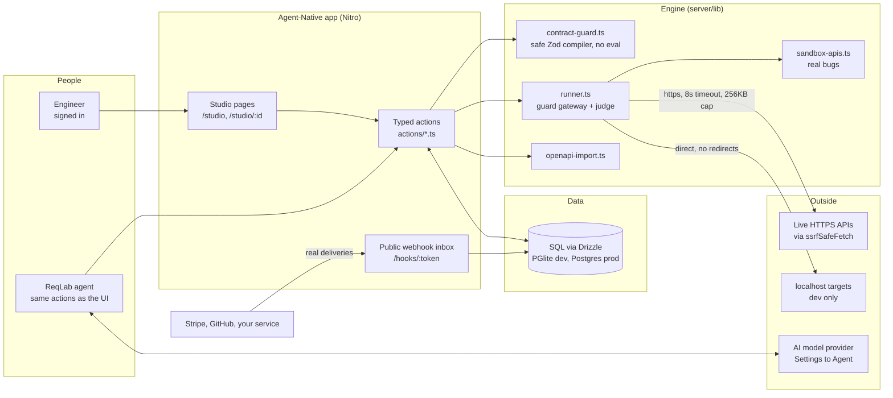
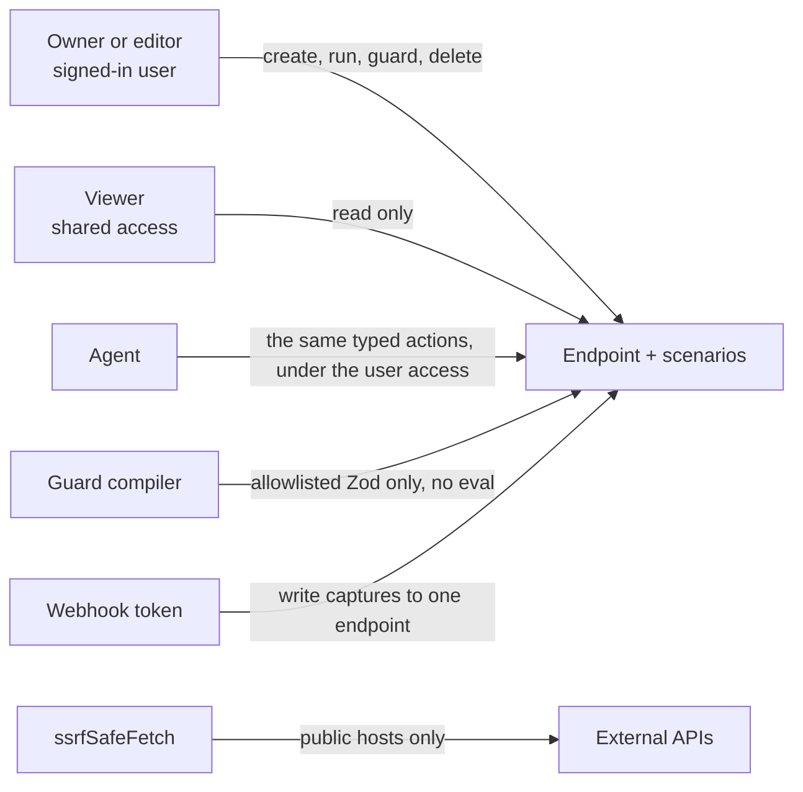
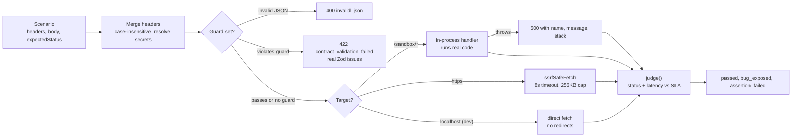
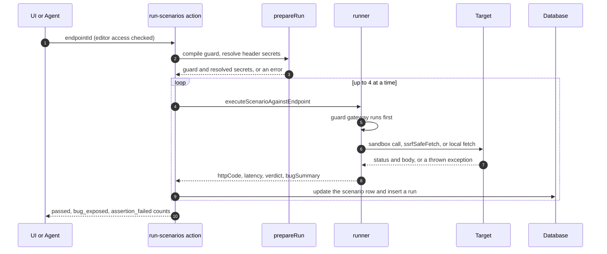
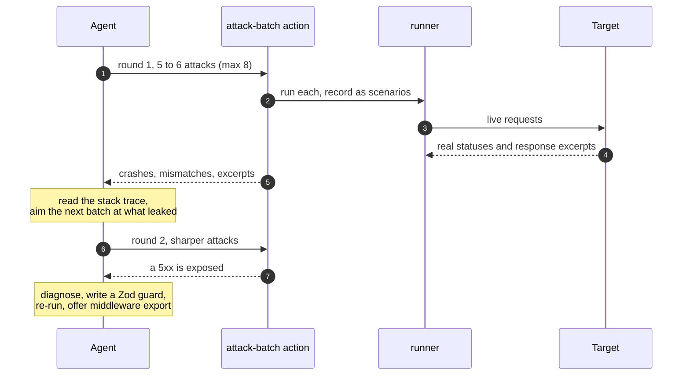
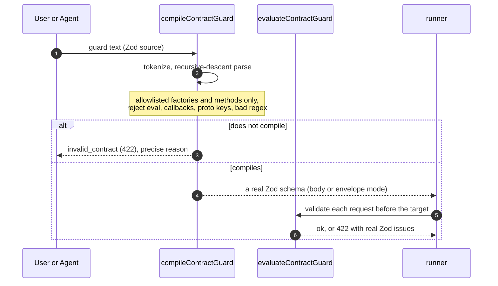

# ReqLab

**Break your APIs on purpose. An AI agent finds the real crash and writes the guard that fixes it, on the same screen you are watching.**

ReqLab is an API, webhook, and chaos-testing studio built on the Agent-Native framework. You point it at an API, it fires adversarial requests, and every result is measured one way: **does the endpoint handle bad input, or does it crash?** When something crashes, the agent reads the real exception, writes a Zod contract guard, and re-runs until the red rows turn green. Nothing here returns a canned error. Every result comes from executing real code or calling a real server.

Built for the Builder.io Agent-Native Hackathon (Nov 2026) · for the judges, and for developers who clone it · App: **[usereqlab.vercel.app](https://usereqlab.vercel.app)** · Demo: **[Watch the 4-min Clips walkthrough](https://clips.agent-native.com/r/z7WjIjLJs6bD)** · Code: [github.com/mrnetwork0001/ReqLab](https://github.com/mrnetwork0001/ReqLab)

**Judges, start here:** open `/studio`, click **Checkout & Charge Ledger API**, press **Run** (two rows turn red with real stack traces), then click **Bug Hunt** and watch the agent diagnose, guard, and re-run until they turn green. For proof it is not a toy, click **Import OpenAPI**, load the Swagger Petstore chip, and run `PUT /pet`: ReqLab finds a real unhandled 500 in a public API it did not write.

---

## The core loop

Four features, one screen shared by you and the agent. Every action is a typed Agent-Native action, so the buttons you click and the agent's tool calls run the exact same code.

| Feature | What it is | Where |
| --- | --- | --- |
| **Chaos Matrix** | An endpoint's scenarios run as a grid of adversarial requests (`boundary`, `injection`, `auth`, `idempotency`, `schema-fuzz`). Each row shows the real HTTP status, latency against the SLA, and the verdict: **passed**, **bug_exposed** (a genuine 5xx crash), or **assertion_failed** (wrong status, for example the API accepted input it should reject). *The crash you see is the actual exception the handler threw, not a fixture.* | `/studio/<endpointId>` → **Run** |
| **Bug Hunt** | One button. The agent attacks the endpoint in rounds through the `attack-batch` action: it reads every response, then designs a sharper next batch aimed at whatever leaked a stack trace or accepted bad input, until it exposes a crash (or four rounds pass). Rows stream into the Matrix live while it reasons in the panel. | `/studio/<endpointId>` → **Bug Hunt** |
| **Contract Guard** | A guard is real Zod source, for example `z.object({ quantity: z.number().int().min(1) })`. ReqLab compiles it with a recursive-descent parser that only invokes allowlisted Zod factories and methods with data-only arguments, so guard text is **never** `eval`ed. The guard runs as a gateway in front of the target, so a bad request gets a `422` with the real Zod issues and never reaches the API. **Export as Middleware** emits it as Express, Hono, or Fetch code to paste into the real service. | guard panel on `/studio/<endpointId>` |
| **Webhook Inbox** | Each endpoint can get a public URL at `/hooks/<token>`. Point Stripe (`stripe listen --forward-to`), GitHub, or your own service at it; real deliveries are captured (cookies and authorization headers dropped, bodies capped at 256 KB, last 50 kept) and any one can be saved as a replayable scenario. | inbox panel on `/studio/<endpointId>` |

### More to explore

| Feature | What it is | Where |
| --- | --- | --- |
| **Import OpenAPI** | Paste an OpenAPI 3.x or Swagger 2.0 spec URL (JSON or YAML). ReqLab creates one endpoint per operation, each seeded with a baseline request built from the schema plus attacks derived from it (negative numbers, type confusion, injection, missing or null required fields, out-of-enum values, oversized strings). Up to 40 operations per import. | `/studio` → **Import OpenAPI** |
| **Demo suite** | Seeds three sandbox APIs with real, unguarded bugs, one live HTTPS API (JSONPlaceholder), and twelve baseline and adversarial scenarios, so the whole find-and-fix loop runs with zero setup. | `/studio` → **Load Demo Sandbox Suite** |
| **Context-aware agent** | The agent panel follows the endpoint on screen: its greeting states the current crash count, and its one-click suggestions change per page ("Fix 2 crashes on Checkout", "Attack this endpoint with 5 new scenarios", "Ship the guard as Express middleware"). | right-hand panel, any `/studio` page |
| **Ask Agent to Fix** | On an endpoint with open crashes, hands the exact failing scenarios and their real errors to the agent and asks for a guard plus a re-run. | `/studio/<endpointId>` |
| **Local targets** | In development, point an endpoint at `http://localhost:PORT` to chaos-test the API you are building. Production blocks loopback targets. | any endpoint's Target URL |

The shell is the Agent-Native workspace: a sign-in gate at `/`, a left sidebar that lists the endpoints under test with a colored crash dot each (red for a crash, amber for a mismatch, green for clean), the agent panel on the right, and the generic chat kept at `/chat`. Sign-in, sharing, and live refresh are the framework's; the Studio is ReqLab's. Endpoint data refreshes live when the agent writes, so a card and the agent's summary never disagree.

## Why the agent is essential

Without the agent, ReqLab is a manual request runner. The agent is what closes the loop from "it crashed" to "it is fixed."

- **No agent, no hunt.** `attack-batch` (`actions/attack-batch.ts`) persists a batch of attacks, runs them live, and returns each real status and response excerpt so the agent can escalate on the next round. The adaptation (read a stack trace, aim the next batch at it) is the agent's work, not a fixed script.
- **No agent, no diagnosis.** A 500 in the Matrix shows the real exception name, message, and project-relative stack frames. Turning that into a root cause and a precise Zod guard is what the agent does through `update-endpoint`.
- **Same code, two drivers.** Every capability is a typed action. The agent calls `run-scenarios`, `update-endpoint`, and `export-contract-guard`; so does the UI. Neither has a private path, so what the agent does, you can do by hand, and the screen stays in sync either way.
- **The agent cannot lie about a result.** It does not generate verdicts. It calls an action, the action executes real code or a real network request, and the verdict is computed from the actual HTTP status and latency (`server/lib/runner.ts`).

## Architecture

ReqLab has four layers:
- **The app:** one Agent-Native (Nitro) app serves every page, action, and the public webhook route.
- **The engine:** pure server libraries compile guards, run scenarios, host the buggy sandbox APIs, and parse specs (`server/lib/`).
- **The data:** SQL through Drizzle holds endpoints, scenarios, run history, shares, and webhook captures. PGlite locally, PostgreSQL in production.
- **The agent:** the framework's chat agent, given ReqLab's actions as tools and a system prompt that teaches the Bug Hunt loop.

The diagrams below render on GitHub.

### System overview



**One app, three surfaces.** `/studio` and `/studio/:endpointId` are the product. `/chat` keeps the generic agent chat. `/hooks/:token` is the only unauthenticated route, and it authenticates by an unguessable per-endpoint token, never a cookie. The template's `/home` landing still exists but is unlinked.

**State.** All structured state is SQL through Drizzle (`server/db/schema.ts`): `endpoints`, `testScenarios`, `scenarioRuns`, `endpointShares`, and `webhookCaptures`. Two migrations create it (`server/plugins/db.ts`). Endpoints are ownable and shareable; scenarios and runs inherit an endpoint's access.

### Trust boundaries: what each actor can and can never do



| Actor | Can | Can never |
| --- | --- | --- |
| Viewer (shared) | Read an endpoint, its scenarios, and runs | Create, run, edit, or delete anything (`accessFilter(..., "editor")` on every write) |
| Owner or editor | Everything on their endpoints: create, run, guard, import, delete, enable a webhook inbox | Act on an endpoint they do not own or hold editor access to |
| The agent | Call the same typed actions, within the signed-in user's access | Fabricate a verdict, reach a private address, or run arbitrary guard code |
| The guard compiler | Build a Zod schema from allowlisted factories and methods with data-only arguments | `eval`, run a `.refine` or `.transform` callback, accept `__proto__` keys, or a catastrophic regex |
| `ssrfSafeFetch` | Call public HTTPS hosts, re-checked after DNS and on every redirect | Reach loopback, private, link-local, or cloud-metadata addresses |
| A webhook token | Append captured requests to its one endpoint | Read data, or authenticate as a user (no cookies are honored) |

Local (`http://localhost:PORT`) targets are allowed only when `NODE_ENV` is not `production` (`server/lib/runner.ts`, `localTargetsAllowed`), so a deployed instance never calls loopback.

### The request pipeline: one scenario, start to verdict



The guard is a gateway: it runs before the target, so a violating request is rejected with the real Zod issues and never reaches the API. `judge()` returns `bug_exposed` for a 5xx when the expected status is below 500, `assertion_failed` for any other status mismatch (with "API accepted input it should reject" when a 4xx was expected and a 2xx came back) or an SLA breach, and `passed` otherwise.

### A scenario run, end to end



### Bug Hunt: the agent adapts



### The guard is safe: compile, then enforce



The compiler never executes guard text. It reads it. Limits: nesting to 32 levels, guard text to 10,000 characters, regex source to 300 characters, and up to 20 reported issues. A `(` in value position fails with a message that functions and callbacks are not allowed. Envelope mode (`z.object({ headers, body })`) validates webhook-style requests, matching header names case-insensitively.

## Safety and security model

- **Guard text is never executed.** `server/lib/contract-guard.ts` is a recursive-descent compiler, not `eval`. It allows a fixed set of Zod factories (object, string, number, boolean, array, enum, literal, union, record, and the common refinements) and methods, all with data-only arguments. It rejects `__proto__`, `constructor`, and `prototype` keys, template interpolation, `.refine` and `.transform` callbacks, regex flags other than `i m s u`, nested-quantifier (catastrophic) regexes, and any regex source over 300 characters.
- **Server-side requests are SSRF-guarded.** External calls go through `ssrfSafeFetch` (`@agent-native/core/extensions/url-safety`), which blocks private, loopback, link-local, and cloud-metadata addresses, re-checks after DNS resolution, and re-validates every redirect hop. Requests time out after 8 seconds (`EXTERNAL_TIMEOUT_MS`) and the response body is capped at 256 KB (`MAX_RESPONSE_BYTES`); stored output is capped at 3,500 characters.
- **Writes require editor access.** Every write action applies `accessFilter(endpoints, endpointShares, undefined, "editor")`, so a viewer can read but never run, edit, or delete. Deleting an endpoint also removes its scenarios, runs, and share rows.
- **Credentials never sit in scenarios.** Header values may reference `{{secret:REQLAB_TARGET_API_KEY}}` (also `_2`, and `REQLAB_WEBHOOK_SIGNING_SECRET`). Only those three ReqLab keys can be referenced, they are resolved server-side only at run time, and their values are redacted from every stored response (`server/lib/target-secrets.ts`). A header can never exfiltrate another app's credential.
- **The webhook inbox is capability-scoped.** `/hooks/<token>` authenticates by an unguessable per-endpoint token, honors no cookies, drops `cookie` and `authorization` headers before storing, rejects bodies over 1 MB, stores at most 256 KB, and keeps the 50 most recent captures.
- **Local targets are development-only.** Loopback is reachable only when `NODE_ENV` is not `production`, and even then with redirects disabled so a local server cannot bounce a request onto a private address.
- **Test coverage.** 29 tests across two Vitest files cover the guard compiler, envelope mode, injection and ReDoS rejection, the real sandbox crashes and their guard fixes, SSRF blocking of `169.254.169.254`, secret redaction, a local-server run, guard export to three frameworks, and OpenAPI parsing. Status is dated below.

## What's real and what's simulated

| Real | Simulated |
| --- | --- |
| External HTTPS calls, through `ssrfSafeFetch`, with real status, latency, and body (capped) | The three `/sandbox/*` target APIs are in-process functions, not separately deployed servers |
| The crashes: genuine exceptions thrown by handler code (a `RangeError` from `Buffer.writeUInt32BE` on a negative total, a `TypeError` from `code.trim()` on an array, a SQL `SyntaxError`, a unique-constraint violation) | The Stripe sandbox's signature check compares against a fixed test secret rather than computing a real HMAC |
| OpenAPI import: fetches and parses a real spec, derives real attacks | |
| The guard compiler and its enforcement (a real Zod schema, a real `422` with real issues) | |
| The webhook inbox: real inbound requests, stored and replayable | |
| The database, sharing, access control, auth, and the agent | |
| The finding that the public Swagger Petstore API returns a real unhandled 500 on an empty `PUT /pet` body | |

The sandbox APIs are simulated **infrastructure** (code running in-process) but not simulated **results**: every 500 is a real exception caught the way an HTTP framework's last-resort handler would catch it, with the real name, message, and project-relative stack frames.

## Tech stack

Agent-Native (`@agent-native/core` 0.226.0), React 19.2, React Router 8.1 (file-system routes), Vite 8.1, Tailwind CSS 4.2, Drizzle ORM 0.45 over PGlite 0.5 (local) and PostgreSQL (production), Zod 4.4, the `yaml` parser 2.9, Vitest 4.1, TypeScript, and the Agent-Native workspace toolkit for the shell, sidebar, sharing, and the agent chat panel. The agent model is whatever the deployment connects in Settings to Agent.

## Run it locally

Prerequisites: Node.js 22+ and pnpm (via `corepack enable`). No external services are needed for local development; data goes to a local PGlite database under `data/`.

```bash
git clone https://github.com/mrnetwork0001/ReqLab.git reqlab && cd reqlab
pnpm install
pnpm dev                 # http://localhost:8080/studio
pnpm test                # guard compiler + sandbox crash/fix + OpenAPI suites
pnpm typecheck
pnpm agent-native:doctor # framework safety guards
```

Connect an AI model in Settings to Agent for the agent panel. Everything else, including the full find-and-fix loop on the sandbox APIs, runs without any keys.

| Variable | What it does | Unset |
| --- | --- | --- |
| `DATABASE_URL` | PostgreSQL connection string for production | Falls back to local PGlite under `data/` |
| `BETTER_AUTH_SECRET` | Signs user sessions | A dev default is used locally; **required in production** |
| `BETTER_AUTH_URL` | Public origin for sign-in and OAuth links | Derived from each request |
| `CRON_SECRET` | Bearer token the once-a-minute job sweep requires | The sweep rejects unauthenticated calls; set it in production |
| `REQLAB_TARGET_API_KEY`, `REQLAB_TARGET_API_KEY_2`, `REQLAB_WEBHOOK_SIGNING_SECRET` | Optional target credentials, set in Settings to API keys and referenced as `{{secret:KEY}}` in headers | Scenarios that reference an unset key fail with `missing_secret` (422) until it is added |

**Test status (2026-11-08):**
- 2 files, **29 of 29 passing** (`Test Files 2 passed (2)` and `Tests 29 passed (29)`).
- `server/lib/chaos-engine.test.ts`: 24 tests (guard compiler, sandbox crashes and fixes, injection and ReDoS rejection, SSRF block, secrets, local-server run, guard export).
- `server/lib/openapi-import.test.ts`: 5 tests (JSON and YAML parsing, derived attacks, Swagger 2.0 host handling).
- `pnpm agent-native:doctor`: clean, no findings.

## Deploying (Vercel)

ReqLab is a server app with a database, so it deploys as Vercel functions with an external PostgreSQL database (Vercel does not persist files, so PGlite cannot be used in production).

1. **Database.** Create a persistent PostgreSQL database (for example Neon or Supabase) and copy its connection string.
2. **Secrets.** `export DATABASE_URL='...'` and `export BETTER_AUTH_SECRET="$(openssl rand -hex 32)"`. Keep the auth secret stable across deploys, or every session is invalidated.
3. **Link and save.** `npx vercel login`, `npx vercel link`, then save `DATABASE_URL` and `BETTER_AUTH_SECRET` (and `CRON_SECRET`) to the project's production environment with `npx vercel env add`.
4. **Migrate.** `pnpm migrate:production` creates the tables in the production database.
5. **Build and deploy.** `NITRO_PRESET=vercel pnpm build`, then `npx vercel deploy --prebuilt --prod`. The command prints the public URL.
6. **Connect a model.** In the deployed app, open Settings to Agent and connect an AI model, or the agent panel will have no brain for visitors.

The scheduled-job sweep (`/_agent-native/jobs/_process-sweep`) is wired as a Vercel cron and requires `CRON_SECRET`. ReqLab has no recurring work of its own, so a daily schedule is fine on the Hobby plan.

Live URL: **[usereqlab.vercel.app](https://usereqlab.vercel.app)** (live on Vercel, backed by Neon Postgres).

## Repository map

```
app/routes/studio.tsx               studio route layout
app/routes/studio._index.tsx        endpoint grid, Import OpenAPI, branded header
app/routes/studio.$endpointId.tsx   Chaos Matrix, payload and guard inspector, Bug Hunt, webhook inbox
app/routes/chat._index.tsx          generic agent chat (kept from the template)
app/components/studio/              GuardExportPanel, WebhookInboxPanel, ImportSpecDialog
app/components/layout/StudioNav.tsx            studio-first sidebar with live crash dots
app/components/layout/AgentInspector.tsx       agent panel that follows the endpoint on screen
app/components/layout/studio-agent-suggestions.ts  per-page agent greeting and one-click prompts
actions/                            17 typed actions: list/get/create/update/delete endpoint and scenario,
                                    run-scenarios, attack-batch, import-openapi, export-contract-guard,
                                    enable-webhook-inbox, list-webhook-captures, seed-demo-suite, navigate, view-screen
server/lib/contract-guard.ts        safe recursive-descent Zod compiler (no eval) and envelope mode
server/lib/runner.ts                guard gateway, sandbox vs external vs local fetch, SSRF, judge()
server/lib/sandbox-apis.ts          three in-process target APIs with real, unguarded bugs
server/lib/scenario-execution.ts    shared prepare / execute / record path (run-scenarios and attack-batch)
server/lib/target-secrets.ts        {{secret:KEY}} resolution and response redaction
server/lib/guard-export.ts          guard to Express, Hono, or Fetch middleware
server/lib/openapi-import.ts        OpenAPI 3.x and Swagger 2.0 parser and attack derivation
server/lib/*.test.ts                chaos-engine (24) and openapi-import (5) Vitest suites
server/routes/hooks/[token].ts      public webhook inbox route
server/db/schema.ts                 endpoints, scenarios, runs, shares, webhook captures
server/db/index.ts                  Drizzle client and endpoint registered as a shareable resource
server/plugins/db.ts                two SQL migrations
server/plugins/agent-chat.ts        the agent's tools and system prompt (Bug Hunt, import, export, secrets)
server/plugins/reqlab-secrets.ts    registers the three target credentials with Settings
server/plugins/auth.ts              makes /hooks public; the rest requires sign-in
.agents/skills/api-chaos-testing/   the agent skill: verdicts, guard syntax, Bug Hunt, import
```

## Credentials and data handling

Target API tokens belong in Settings to API keys as the three `REQLAB_*` secrets and are referenced from headers as `{{secret:KEY}}`; they are resolved only at run time and redacted from stored responses. The webhook inbox drops `cookie` and `authorization` headers before storing a capture and keeps only the 50 most recent. ReqLab stores no third-party credentials in the database and sends a user's token only in the outbound request that needs it.

## Pre-existing work and credits

- **Agent-Native "chat" template** from `@agent-native/core` (the app shell, sign-in, sidebar, agent chat panel, sharing, live sync, i18n scaffolding, and the unlinked `/home` landing). ReqLab replaces the home path with `/studio` and adds the Studio, its actions, and its engine on top.
- **`ssrfSafeFetch`** and the workspace toolkit are framework-provided.
- **`yaml`** (2.9.1) parses imported specs. Other open-source packages are listed in `package.json`.
- **JSONPlaceholder** and the **Swagger Petstore** are public demo APIs used as live external targets.
- **No prior ReqLab code.** Everything in the Studio, the actions, and `server/lib/` was written for this hackathon.

## License

No license file is set yet. The Agent-Native framework and its template carry their own licenses (see `node_modules/@agent-native/*`). Third-party demo APIs (JSONPlaceholder, Swagger Petstore) belong to their owners.

---

ReqLab is an independent Builder.io Agent-Native Hackathon project. The three sandbox APIs are intentionally buggy demo targets; every crash they produce is a real exception, not a fixture. ReqLab also runs against any live HTTPS API, where results come straight from the network.
